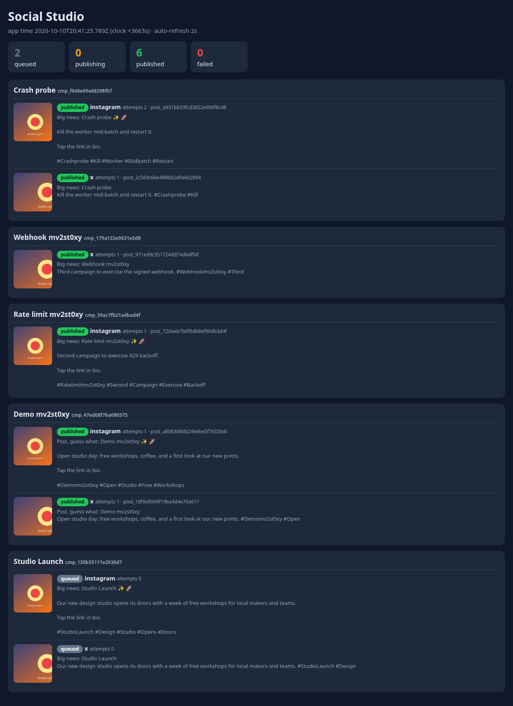

# Social Studio — multi-platform social campaign publisher

FlyRank capstone **CAP-social-a**. Create a campaign once; get a correctly sized image and a platform-tailored caption
for **Instagram (1080×1080)** and **X (1600×900)**, publish or schedule it, and be sure each platform receives it
**exactly once** — through double-clicks, timeouts, 429s, crashed workers and forged webhooks.



## Architecture

```
 client ──HTTP──▶  API (express 5, zod validation)                         fake platform (own stand-in)
                    │  routes → services → repositories → SQLite (WAL)       ├ POST /oauth/token
                    │                         ▲                              ├ POST /v1/instagram/media
                    │ POST /webhook/social-   │ lease/claim                  ├ POST /v1/x/tweets
                    │  delivery (HMAC-SHA256) │                              │   Idempotency-Key, 429, drops, 5xx
                    ▼                         │                              └ signed delivery webhooks ──┐
              ┌──────────┐   claim due   ┌────┴─────┐  SocialPublisher     │                              │
              │ campaigns│◀──entries────▶│  worker  │──(IG / X adapters)───┘                              │
              │ entries  │               └──────────┘  AES-GCM-decrypted OAuth token                      │
              └──────────┘ ◀────────────────────── verified webhook marks published|failed ◀─────────────┘
```
Layers: `http` (routing, validation, error mapping) → `services` (rules) → `domain` (images, captions, token vault,
clock) / `repositories` (SQL only) → `adapters` (one `SocialPublisher` interface, two implementations). Details and
rationale: [`docs/DESIGN.md`](docs/DESIGN.md).

**Statuses:** `queued → publishing → published | failed`. An entry goes `publishing` when the platform accepted the post
(HTTP 202) and becomes `published`/`failed` **when the signed delivery webhook arrives**. Fallback: if a webhook is lost,
a reconcile sweep asks the platform (authenticated `GET /v1/posts/:id`) after 60 s.

**Why no double posts** (three independent layers): `UNIQUE(campaign_id, platform)` in the DB; an atomic leased claim
(`BEGIN IMMEDIATE`, lease expiry lets another worker take over a crashed one's work); and the platform `Idempotency-Key`
(`<campaignId>:<platform>`) so a re-sent request after a timeout/crash returns the original post.

## Run it

Needs Node ≥ 22.13 (uses built-in `node:sqlite`).

```bash
npm ci
npm start          # 3 processes: fake platform :4010, API :3000, worker. Creates .env with random secrets on first run.
npm run seed       # (second terminal) connect both OAuth accounts + create the "Studio Launch" demo campaign
open http://localhost:3000/dashboard
npm run demo       # scripted walkthrough: images+captions, schedule+advance time, idempotency hammer, 429, forged vs valid webhook
npm test           # 29 tests, in-process, no network needed
```

Docker alternative: `docker compose up --build`, then `docker compose run --rm seed`
(secrets are generated once into the `data` volume). **Not verified** — see limitations.

### Demo time travel
The app clock is real time + an offset stored in the database (shared by API and worker). `POST /admin/clock/advance
{"seconds": 3601}` moves it forward so scheduled posts and 429 waits can be shown without sleeping. Admin routes exist
only while `ENABLE_ADMIN=1` (default for the demo; set `0` otherwise).

### Fault injection (the fake platform)
`POST :4010/__admin/faults` with any of `rateLimitNext`, `retryAfter`, `failNext`, `dropNext` (close the socket after
accepting), `randomFailRate`, `webhookFailRate`, `webhookDelayMs`; `GET :4010/__admin/state` shows what the "platform"
really holds.

## API

| Method | Path | Notes |
|---|---|---|
| POST | `/campaigns` | `{name, summary, brandVoice?, platforms?, imageBase64?, subject?, scheduleAt?}`; `Idempotency-Key` header supported; returns images + captions per platform |
| GET | `/campaigns`, `/campaigns/:id` | campaign with its `entries` (status, caption, imageUrl, attempts, nextAttemptAt, externalId) |
| POST | `/campaigns/:id/publish` | queue now (idempotent) |
| POST | `/campaigns/:id/schedule` | `{at: ISO string | epoch ms}` |
| GET | `/media/:campaignId/:platform.jpg` | the generated variant |
| POST | `/webhook/social-delivery` | `X-Signature: sha256=<hmac>`; forged/modified → **400**, no state change |
| GET | `/dashboard`, `/dashboard.json`, `/health` | |

Invalid input is always a 4xx with details (zod, `.strict()` bodies, id format checks, size limits), never a 500.

## Configuration
See `.env.example`. Secrets (`TOKEN_ENC_KEY` 32 bytes hex, `WEBHOOK_SECRET`, `OAUTH_CLIENT_SECRET`) are never committed;
`.env` is git-ignored and `npm start` generates one. OAuth access/refresh tokens are stored as AES-256-GCM
(`v1.<iv>.<tag>.<ct>`, random IV, AAD bound to the platform) and the logger redacts token-like keys and values.

## Honest notes and limitations
- **The "fake platform" is my own stand-in.** The brief mentions a provided starter (`starters/challenge-5-social/`) that I
  did not have. `src/fake-platform/` imitates OAuth, 429/`Retry-After`, `Idempotency-Key`, dropped responses and signed
  webhooks, but request/response shapes are my guesses, so pointing the adapters at the official one may need small
  adapter changes. No real Instagram/X API is called.
- **AI is not used** anywhere in the product; captions are deterministic (shared fragments + platform rules).
  [`BUILDLOG.md`](BUILDLOG.md) says honestly how the code was written.
- SQLite = single node (fine for the demo; multiple workers on one DB are tested, multiple hosts are not).
- Fake platform state is in memory; restarting it forgets its posts (the app's own DB is durable).
- Fault injection counts ("next N calls") rather than rates; `randomFailRate` is available for chaos.
- Subject detection is not automatic: the caller may pass a `subject` box (fractions); default is the image centre.
- Docker files were written but **not run** (no working Docker daemon on the machine used), only `docker compose config` was checked.
- Stretch goals (real platform publishing, A/B captions, approval flow, analytics) are not implemented.

## Repo map
`src/` http · services · domain · repositories · adapters · jobs · fake-platform · db/migrations — `bin/` start/seed/demo —
`test/` — `evidence/` captures used by [`EVIDENCE.md`](EVIDENCE.md) — `capstone.yaml` machine-readable run/seed/test info.
